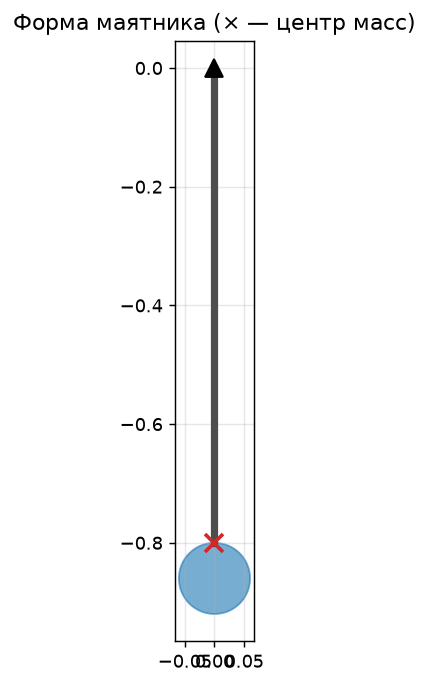
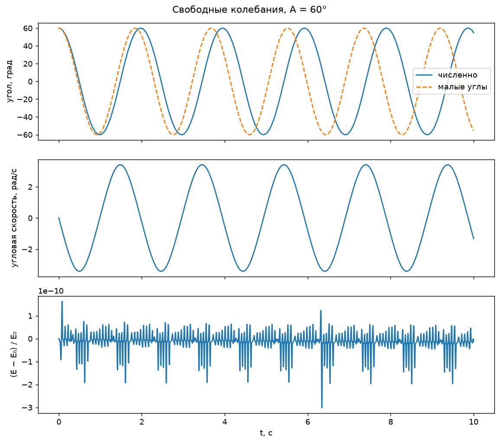
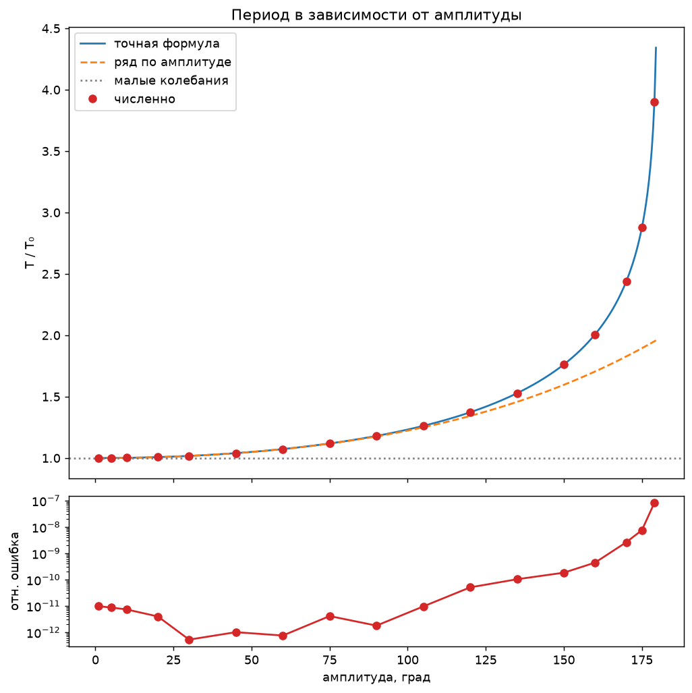
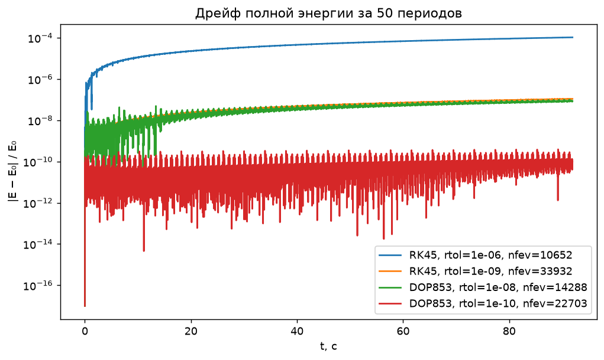
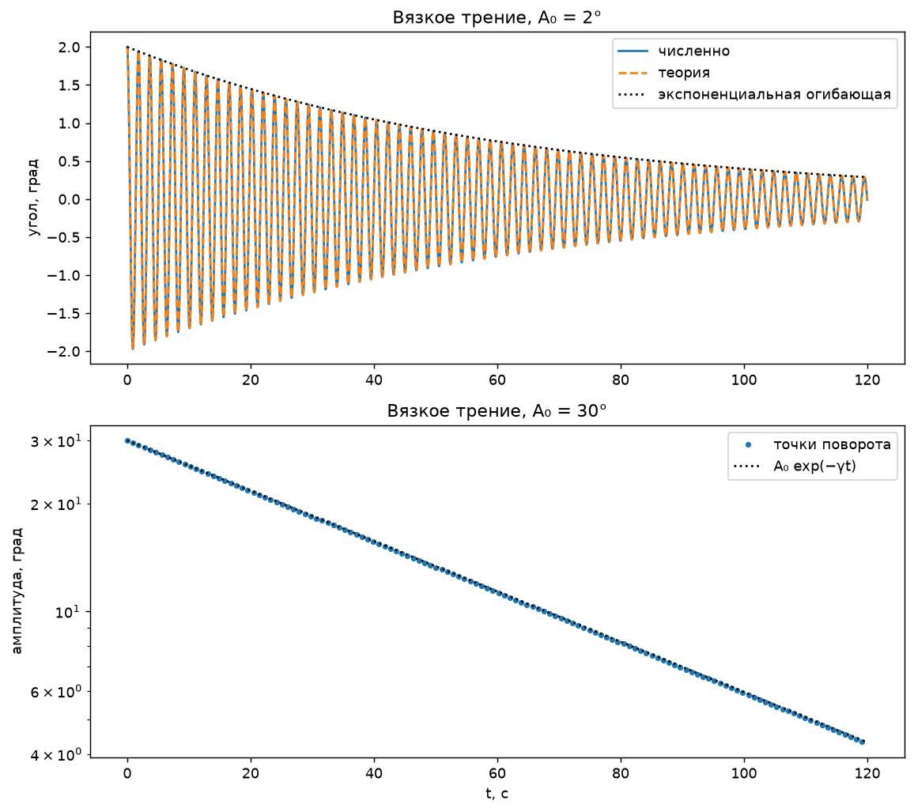

# M5. Физический маятник

## 1. Постановка задачи

Цель работы — построить численную модель физического маятника, то есть
произвольного твёрдого тела, способного вращаться вокруг неподвижной
горизонтальной оси в поле тяжести.
В качестве маятника выбрано составное тело «тонкий стержень + сплошной
шар».

## 2. Форма и инерционные характеристики маятника

### 2.1. Общий способ построения тела

Маятник собирается из простых тел, описанных в `src/shapes.py`: шара,
диска, кольца, тонкого стержня и прямоугольной пластины. Для каждой части
задаются масса $m_i$, положение центра масс $\mathbf r_i$ относительно оси
подвеса и момент инерции $I_{cm,i}$ относительно собственного центра масс.

Для составного тела вычисляются

$$
m = \sum_i m_i,
\qquad
\mathbf r_c = \frac{\sum_i m_i\mathbf r_i}{m},
\qquad
d = \lVert\mathbf r_c\rVert.
$$

Момент инерции относительно оси подвеса находится по теореме Штейнера:

$$
I = \sum_i\left(I_{cm,i}+m_i\lVert\mathbf r_i\rVert^2\right).
$$

Такой способ позволяет менять конструкцию маятника без изменения уравнения
движения.

### 2.2. Выбранная конструкция

Маятник из `scenarios/pendulums/rod_with_sphere.py` состоит из:

- стержня длиной $L=0.8$ м и массой $m_r=0.3$ кг;
- сплошного шара радиусом $R=0.06$ м и массой $m_s=2.0$ кг;
- центра шара на расстоянии $0.86$ м от оси подвеса.

Для стержня $I_{cm}=m_rL^2/12$, для шара
$I_{cm}=2m_sR^2/5$. Расчёт отдельных вкладов приведён в таблице.

| часть | масса, кг | расстояние до центра части, м | $I_{cm}$, кг·м² | $mr^2$, кг·м² | $I$ относительно подвеса, кг·м² |
|---|---:|---:|---:|---:|---:|
| стержень | 0.3 | 0.40 | 0.01600 | 0.04800 | 0.06400 |
| шар | 2.0 | 0.86 | 0.00288 | 1.47920 | 1.48208 |
| **всё тело** | **2.3** | — | — | — | **1.54608** |

Координата общего центра масс по вертикали:

$$
y_c=\frac{0.3\cdot(-0.4)+2.0\cdot(-0.86)}{2.3}=-0.800\ \text{м}.
$$

Итоговые характеристики маятника:

| величина | значение |
|---|---:|
| масса $m$ | $2.3$ кг |
| расстояние до центра масс $d$ | $0.800$ м |
| момент инерции $I$ | $1.54608$ кг·м² |
| приведённая длина $l=I/(md)$ | $0.840261$ м |
| частота малых колебаний $\omega_0$ | $3.416862$ рад/с |
| период малых колебаний $T_0$ | $1.838876$ с |

## 3. Входные и выходные данные

### 3.1. Входные параметры

Рабочая комбинация маятника, режима и численного решателя выбирается в
`config.py`. Начальные состояния отдельных экспериментов находятся в
`scenarios/modes/`.

| параметр | свободные колебания | затухание большой амплитуды | затухание малой амплитуды |
|---|---:|---:|---:|
| начальный угол $\varphi_0$ | $60^\circ$ | $30^\circ$ | $2^\circ$ |
| начальная скорость $\dot\varphi_0$ | $0$ | $0$ | $0$ |
| вязкое трение $b$ | $0$ | $0.05$ Н·м·с | $0.05$ Н·м·с |
| время моделирования | $10$ с | $120$ с | $120$ с |

Общие параметры:

| параметр | значение |
|---|---:|
| ускорение свободного падения $g$ | $9.81$ м/с² |
| метод интегрирования | `DOP853` |
| относительный допуск `rtol` | $10^{-10}$ |
| абсолютный допуск `atol` | $10^{-12}$ |

Основные ограничения имеют физическое и численное обоснование:

- каждая часть тела должна иметь положительную массу;
- маятник должен содержать хотя бы одну часть;
- центр масс не должен совпадать с осью подвеса, то есть $d>0$;
- геометрические размеры и $g$ должны быть положительными по физическому
  смыслу;
- коэффициент вязкого трения должен удовлетворять $b\geq0$;
- при измерении периода амплитуда должна лежать в интервале
  $0<A<\pi$: при $A=\pi$ тело находится в неустойчивом верхнем положении,
  а период стремится к бесконечности;
- аналитическая формула затухания применяется только для малых углов и
  слабого трения, когда $\gamma\ll\omega_0$.

### 3.2. Выходные данные

Численное решение содержит значения времени, угла $\varphi(t)$ и угловой
скорости $\dot\varphi(t)$. На их основе рассчитываются период, кинетическая,
потенциальная и полная энергии, точки поворота и показатель затухания.

## 4. Математическая модель

### 4.1. Нелинейное уравнение движения

Пусть $\varphi$ — угол отклонения линии «ось подвеса — центр масс» от
вертикального положения вниз, а $b$ — коэффициент вязкого трения в оси.
Уравнение моментов относительно оси подвеса имеет вид

$$
I\ddot\varphi=-mgd\sin\varphi-b\dot\varphi,
$$

Полная механическая энергия отсчитывается от нижнего положения:

$$
E=\frac{I\omega^2}{2}+mgd(1-\cos\varphi).
$$

Для $b=0$ из уравнения движения следует $dE/dt=0$. При вязком трении

$$
\frac{dE}{dt}=-b\omega^2\leq0,
$$

поэтому энергия должна монотонно уменьшаться.

### 4.2. Свободные колебания без трения

В приближении малых углов $\sin\varphi\approx\varphi$:

$$
\omega_0=\sqrt{\frac{mgd}{I}},
\qquad
T_0=2\pi\sqrt{\frac{I}{mgd}}.
$$

$$
T(A)=4\sqrt{\frac{I}{mgd}}
\int_0^{\pi/2}
\frac{d\theta}
{\sqrt{1-\sin^2(A/2)\sin^2\theta}}.
$$

Для умеренных амплитуд используется разложение

$$
T(A)\approx T_0\left(1+\frac{A^2}{16}+\frac{11A^4}{3072}\right).
$$

### 4.3. Затухающие колебания

$$
\ddot\varphi+2\gamma\dot\varphi+\omega_0^2\varphi=0,
\qquad
\gamma=\frac{b}{2I}.
$$

Для $\gamma<\omega_0$ и начальных условий
$\varphi(0)=A_0$, $\dot\varphi(0)=0$ решение имеет вид

$$
\varphi(t)=A_0e^{-\gamma t}
\left(\cos\omega_dt+\frac{\gamma}{\omega_d}\sin\omega_dt\right),
\qquad
\omega_d=\sqrt{\omega_0^2-\gamma^2}.
$$

Амплитуда убывает по закону $A(t)\sim A_0e^{-\gamma t}$. Для выбранного
$b=0.05$ Н·м·с:

$$
\gamma=0.0161699\ \text{с}^{-1},
\qquad
Q=\frac{\omega_0}{2\gamma}=105.65.
$$

## 5. Результаты численных экспериментов

### 5.1. Свободные колебания

Маятник отпускается без начальной скорости из положения $A=60^\circ$.
Энергия в начальный момент равна $E_0=9.0252$ Дж. Получены

$$
T_0=1.838876\ \text{с},
\qquad
T(60^\circ)=1.973449\ \text{с}.
$$

Нелинейный период на $7.32\%$ больше периода малых колебаний. Поэтому
численное решение и гармоническое приближение постепенно расходятся по
фазе, хотя начинаются из одинакового положения. Максимальный относительный
дрейф энергии за $10$ с равен $3.019\cdot10^{-10}$.

### 5.2. Зависимость периода от амплитуды

| $A$, град | $T$ численно, с | $T$ точно, с | относительная ошибка | $T/T_0$ | ряд $T/T_0$ |
|---:|---:|---:|---:|---:|---:|
| 1 | 1.838911 | 1.838911 | $1\cdot10^{-11}$ | 1.0000 | 1.0000 |
| 10 | 1.842383 | 1.842383 | $7\cdot10^{-12}$ | 1.0019 | 1.0019 |
| 30 | 1.870889 | 1.870889 | $5\cdot10^{-13}$ | 1.0174 | 1.0174 |
| 60 | 1.973449 | 1.973449 | $4\cdot10^{-13}$ | 1.0732 | 1.0728 |
| 90 | 2.170500 | 2.170500 | $2\cdot10^{-12}$ | 1.1803 | 1.1760 |
| 120 | 2.524557 | 2.524557 | $5\cdot10^{-11}$ | 1.3729 | 1.3431 |
| 150 | 3.240474 | 3.240474 | $2\cdot10^{-10}$ | 1.7622 | 1.5966 |
| 170 | 4.485685 | 4.485685 | $3\cdot10^{-9}$ | 2.4394 | 1.8277 |
| 179 | 7.173574 | 7.173575 | $8.24\cdot10^{-8}$ | 3.9011 | 1.9511 |

Максимальная относительная ошибка численного периода по сравнению с точной
формулой составила $8.238\cdot10^{-8}$. Период монотонно увеличивается с
амплитудой. Отклонение от $T_0$ достигает $1\%$ при
$A\approx22.81^\circ$. Разложение по амплитуде даёт ошибку около $0.4\%$
при $90^\circ$, но далее теряет точность. При $A\to180^\circ$ точный
период логарифмически стремится к бесконечности, тогда как конечный ряд
этого поведения воспроизвести не может.

### 5.3. Сохранение энергии и выбор решателя

Для одного начального состояния рассчитан максимальный дрейф энергии за
50 периодов.

| метод | `rtol` | `atol` | максимальный $\lvert\Delta E\rvert/E_0$ |
|---|---|---|---|
| RK45 | $10^{-6}$ | $10^{-9}$ | $1.053\cdot10^{-4}$ |
| RK45 | $10^{-9}$ | $10^{-12}$ | $1.099\cdot10^{-7}$ |
| DOP853 | $10^{-8}$ | $10^{-10}$ | $1.011\cdot10^{-7}$ |
| DOP853 | $10^{-10}$ | $10^{-12}$ | $3.915\cdot10^{-10}$ |

Уменьшение допусков снижает дрейф энергии более чем на пять порядков по
сравнению с первым вариантом. Используемая комбинация `DOP853`,
`rtol=1e-10`, `atol=1e-12` обеспечивает погрешность, пренебрежимо малую
для исследуемых зависимостей. Метод не является симплектическим, поэтому
энергия не сохраняется тождественно; её дрейф служит практической оценкой
качества интегрирования.

### 5.4. Затухающие колебания

Для проверки линейной теории использовано малое начальное отклонение
$A_0=2^\circ$; маятник отпущен без начальной скорости. Получено:

| величина | теория | численно |
|---|---|---|
| показатель затухания $\gamma$, с$^{-1}$ | 0.016169927 | 0.016170140 |
| относительное расхождение | — | $1.32\cdot10^{-5}$ |

Максимальное отличие нелинейного численного решения от линейной формулы за
120 с составляет $3.097\cdot10^{-3}$ начальной амплитуды, то есть около
$0.31\%$. Это расхождение объясняется сохранением $\sin\varphi$ в численной
модели.

При $A_0=30^\circ$ зависимость точек поворота от времени остаётся близкой к
экспоненциальной, но аппроксимация даёт
$\gamma_{num}=0.016217940$ с$^{-1}$, что на $0.297\%$ выше линейного
значения. Таким образом, линейная теория хорошо описывает малые углы, а
численная модель позволяет количественно увидеть начало нелинейных
поправок.

## 6. Аналитические тесты

| группа | что проверяется | критерий | число случаев |
|---|---|---|---:|
| геометрия | моменты инерции шара, диска, кольца, стержня и пластины | известные формулы для $I_{cm}$ | 5 |
| составное тело | масса, центр масс и теорема Штейнера | $m=2.3$ кг, $y_c=-0.8$ м, $I=1.54608$ кг·м² | 1 |
| ограничения тела | пустой набор частей, неположительная масса, $d=0$ | ожидается `ValueError` | 4 |
| энергия без трения | постоянство $E(t)$ | максимальный дрейф $<10^{-8}$ | 1 |
| малые колебания | численный и гармонический периоды | относительная ошибка $<10^{-5}$ | 1 |
| нелинейный период | сравнение с точной формулой при $30^\circ$, $90^\circ$, $150^\circ$ | относительная ошибка $<10^{-7}$ | 3 |
| зависимость периода | рост $T(A)$ | $T(5^\circ)<T(60^\circ)<T(120^\circ)$ | 1 |
| ограничения амплитуды | $A\leq0$ и $A\geq\pi$ | ожидается `ValueError` | 4 |
| энергия с трением | монотонное уменьшение энергии | $\Delta E\leq10^{-9}E_0$ с учётом численной ошибки | 1 |
| линейное затухание | сравнение $\varphi(t)$ с аналитическим решением | ошибка $<10^{-3}A_0$ | 1 |
| показатель затухания | аппроксимация точек поворота | относительная ошибка $<5\cdot10^{-4}$ | 1 |
| ограничение трения | отрицательное $b$ | ожидается `ValueError` | 1 |

Все 24 тестовых случая успешно пройдены

Тесты подтверждают расчёт момента инерции, сохранение энергии, точность
численного периода, ожидаемую зависимость периода от амплитуды и закон
слабого вязкого затухания.

## 7. Границы применимости

- Тело считается абсолютно твёрдым, ось подвеса — неподвижной.
- Рассматривается только плоское движение.
- Трение принято линейным по угловой скорости.
- Формулы малых колебаний и линейного затухания применимы только при
  $|\varphi|\ll1$ и $\gamma\ll\omega_0$.

## 8. Выводы

1. Для составного маятника «стержень + шар» рассчитан момент инерции
   $I=1.54608$ кг·м² и приведённая длина $0.840261$ м.
2. При отсутствии трения полная механическая энергия сохраняется:
   максимальный относительный дрейф при выбранных настройках решателя
   составил $3.915\cdot10^{-10}$ за 50 периодов.
3. Гармоническое приближение пригодно только для малых углов: уже при
   $A\approx22.81^\circ$ отличие периода достигает $1\%$, а при
   $60^\circ$ — $7.32\%$.
4. При малом вязком трении амплитуда убывает практически экспоненциально.
   Для $A_0=2^\circ$ численный показатель затухания совпал с линейной
   теорией с относительным расхождением $1.32\cdot10^{-5}$.
5. Аналитические тесты подтвердили как отдельные инерционные формулы, так
   и поведение модели в целом: сохранение энергии, нелинейный период и
   затухающие колебания.
